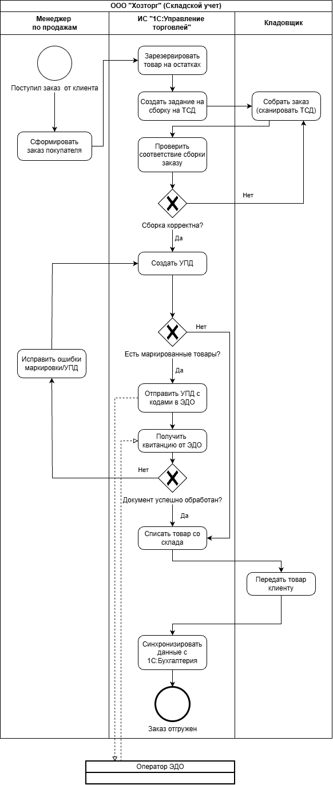

Дисциплина: «Проектирование информационных систем»

# Практическая работа № 2. «Разработка концепции информационной системы»

**Концепция информационной системы складского учёта ООО «Хозторг»**

Преподаватель: Юрий Бондарев\
Год: 2026

## Состав команды и распределение ролей

| Участник                      | Роль на стадии концепции                                                                   | Вклад в отчёт                                                                            |
|-------------------------------|--------------------------------------------------------------------------------------------|------------------------------------------------------------------------------------------|
| Юрий Бондарев (преподаватель) | Заказчик: задаёт приоритеты и ограничения, согласует критерии и веса, утверждает концепцию | —                                                                                        |
| Валерия Просветова            | Бизнес-аналитик: обследует объект, формулирует требования пользователя                     | Объект автоматизации, требования, обзор аналогов (разделы 1–2)                           |
| Марина Журбина                | Архитектор: предлагает технические варианты, оценивает их реализуемость и ограничения      | Альтернативные варианты концепции (раздел 3)                                             |
| Роман Тихонов                 | Системный аналитик: сопоставляет варианты с требованиями, строит модель TO-BE              | Обоснование выбора и целевой процесс (разделы 4–5)                                       |
| Вероника Сусликова            | Руководитель проекта: оценивает бюджет, сроки и риски                                      | Экономический эффект и риски (разделы 6–7)                                               |
| Никита Мурашов                | Специалист по ИБ и приёмке: требования к защите данных, показатели качества                | Показатели качества, порядок приёмки, выводы, сведение и оформление отчёта (разделы 8–9) |

## 1 Характеристика объекта автоматизации и требования пользователя

Объектом автоматизации является складской учёт ООО «Хозторг» — небольшой компании, занимающейся оптовой и розничной
продажей хозяйственных товаров. Оптовыми покупателями выступают магазины и строительные, клининговые и иные организации,
а розничная торговля осуществляется через магазин при складе. Компания располагает одним складом, ассортимент которого
составляет около 2 500 товарных позиций. Бюджет на внедрение информационной системы составляет не более 2 млн рублей, а
ежегодные расходы на её сопровождение — не более 100 тыс. рублей, а срок внедрения — не более 4 месяцев.

Предприятие сотрудничает с 15–20 поставщиками и ежедневно обрабатывает 30–40 оптовых заказов. Часть ассортимента
составляет бытовая химия, для которой с 1 июля 2026 года действуют требования по приёмке и оптовой отгрузке через
электронный документооборот (ЭДО) \[1\]. Поскольку результаты предыдущей стадии проектирования отсутствовали, описание
текущего процесса (AS-IS), перечень проблем и исходные ограничения были подготовлены командой самостоятельно по
согласованию с преподавателем. Все количественные показатели являются условными.

В складском учёте задействованы 10 сотрудников. Директор отвечает за утверждение закупок и контроль деятельности
предприятия, поэтому ему необходим доступ к актуальным отчётам. Четыре менеджера, трое из которых занимаются продажами,
а один — закупками, обрабатывают заказы клиентов и взаимодействуют с поставщиками. Для эффективной работы им важно
оперативно получать информацию о доступных остатках товаров. Четыре кладовщика отвечают за приёмку, сборку и отгрузку
товаров, обслуживание розничных покупателей и проведение инвентаризации. Использование сканеров штрихкодов позволит им
сократить объём ручной работы. Бухгалтер ведёт учёт в программе «1С:Бухгалтерия» и заинтересован в автоматической
передаче документов без необходимости повторного ввода данных.

В настоящее время складской учёт ведётся в общем файле Excel, а бухгалтерские документы оформляются в «1С:Бухгалтерии».
Эти системы не связаны между собой, поэтому одни и те же сведения приходится вводить несколько раз. Данные о поступлении
и отгрузке товаров кладовщики заносят в Excel в конце рабочего дня, после чего бухгалтер повторно отражает операции в
1С. Для маркированных товаров дополнительно оформляются универсальные передаточные документы (УПД) через ЭДО\[1\]. Поиск
товаров на складе осуществляется без системы адресного хранения, что увеличивает время сборки заказов и вероятность
ошибок. Инвентаризация проводится раз в квартал и требует остановки работы склада на два дня. Основные недостатки
существующего процесса и требования, направленные на их устранение, представлены в таблице 1.

**Таблица 1 – Проблемы текущего процесса (AS-IS)**

| Код | Проблема и как она проявляется                                                                                                                                           | Требования             |
|-----|--------------------------------------------------------------------------------------------------------------------------------------------------------------------------|------------------------|
| П1  | Расхождения между учётными и фактическими остатками: при инвентаризации выявляются несоответствия примерно по 6% товарных позиций.                                       | ФТ-2, ФТ-3, ФТ-5       |
| П2  | Несвоевременное обновление остатков: поступления и отгрузки отражаются в конце рабочего дня, из-за чего примерно каждый 20-й заказ требует корректировки после сборки.   | ФТ-3, ФТ-4, ФТ-9       |
| П3  | Дублирование ввода данных в Excel, 1С и ЭДО: бухгалтер затрачивает на повторные операции около 10 часов в неделю.                                                        | ФТ-6, ФТ-7             |
| П4  | Длительная инвентаризация: проводится раз в квартал, занимает два рабочих дня и требует участия всех четырёх кладовщиков. На это время работа склада приостанавливается. | ФТ-5, ФТ-11            |
| П5  | Ошибки при приёмке и сборке заказов из-за отсутствия сканирования штрихкодов и адресного хранения.                                                                       | ФТ-1, ФТ-2,ФТ-3, ФТ-12 |
| П6  | Отсутствие контроля изменений: сотрудники могут редактировать общий файл Excel без фиксации выполненных действий                                                         | ФТ-8, НФТ-1            |
| П7  | Недостаточно эффективное планирование закупок из-за отсутствия данных об оборачиваемости и залежавшихся товарах.                                                         | ФТ-10                  |

Требования к информационной системе разделены на три группы: функциональные, нефункциональные и ограничения (таблица 2).
Их приоритеты определены по методу MoSCoW. Требования Must являются обязательными и будут учитываться при дальнейшем
сравнении вариантов автоматизации складского учёта.

**Таблица 2 – Требования пользователя**

| Группа           | Обязательные (Must)                                                                                                                                                                                                                                                                                                                                                                                                                                                                                                                                                                                                                                                  | Остальные (Should, Could, Won’t)                                                                                                                                                                                                                                                                                                                                                                                                                   |
|------------------|----------------------------------------------------------------------------------------------------------------------------------------------------------------------------------------------------------------------------------------------------------------------------------------------------------------------------------------------------------------------------------------------------------------------------------------------------------------------------------------------------------------------------------------------------------------------------------------------------------------------------------------------------------------------|----------------------------------------------------------------------------------------------------------------------------------------------------------------------------------------------------------------------------------------------------------------------------------------------------------------------------------------------------------------------------------------------------------------------------------------------------|
| Функциональные   | ФТ-1 — ведение справочника товаров с возможностью создания этикеток со штрихкодами; ФТ-2 — приёмка товаров по заказу с использованием сканера и фиксацией расхождений; ФТ-3 —оформление отгрузок с резервированием товаров при создании заказа и проверкой собранных товаров с помощью сканера; ФТ-4 — автоматическое обновление остатков после складских операций; ФТ-5 — проведение инвентаризации со сканером и оформление документов по излишкам и недостачам; ФТ-6 — обмен данными и документами с 1С:Бухгалтерией; ФТ-7 — поддержка электронного документооборота и маркировки «Честный знак»; ФТ-8 — ведение журнала складских операций с историей изменений. | Should: ФТ-9 — автоматическое списание товаров после розничных продаж по данным кассы; ФТ-10 — формирование отчётов по оборачиваемости товаров и планирование закупок с учётом минимальных остатков; ФТ-11 — выполнение складских операций с помощью терминала сбора данных (ТСД). Could: ФТ-12 — учёт мест хранения товаров на складе для упрощения их поиска. Won't: ФТ-13 — интеграция с маркетплейсами, не планируется на текущем этапе. |
| Нефункциональные | НФТ-1 — разграничение прав доступа сотрудников в зависимости от их должности; НФТ-2 — одновременная работа до 8 пользователей со временем выполнения операций не более 2 секунд; НФТ-3 — ежедневное резервное копирование данных с возможностью восстановления за 4 часа; НФТ-4 — интерфейс на русском языке и поддержка документов УПД, ТОРГ-12 и ИНВ-3.                                                                                                                                                                                                                                                                                                            | Should: НФТ-5 — понятный и удобный интерфейс информационной системы, позволяющий обучить сотрудников работе с ней за один день; НФТ-6 — возможность расширения учёта до 10 000 товарных позиций и двух складов.                                                                                                                                                                                                                                    |
| Ограничения      | О-1 — расходы на создание и внедрение системы не более 2 млн ₽; О-2 — ежегодные расходы на обслуживание не более 100 тыс. ₽; О-3 — внедрение системы в течение 4 месяцев; О-4 — хранение персональных данных на серверах в России в соответствии с 152-ФЗ [2]; О-5 — сохранение действующей системы 1С:Бухгалтерия; О-6 — обязательная работа с маркированными товарами через ЭДО [1].                                                                                                                                                                                                                                                                               | Дополнительные ограничения не предусмотрены                                                                                                                                                                                                                                                                                                                                                                                                        |

## 2 Аналитический обзор аналогов и готовых решений

Для сравнения готовых решений по автоматизации складского учёта рассмотрены четыре российские системы и зарубежная Odoo.
Сравнение проведено по функциям складского учёта, стоимости для 10 пользователей, возможностям интеграции и способам
хранения данных (таблица 3). Цены приведены по данным сайтов разработчиков и партнёров на октябрь 2026 года без учёта
индивидуальных скидок.

**Таблица 3 – Сравнение готовых решений**

| Система                    | Функции (требования Must)                                                                                                                                                                                       | Лицензия и цена на 10 пользователей                                                                                                                                        | Интеграции                                                                                                                                             | Размещение данных                                                 |
|----------------------------|-----------------------------------------------------------------------------------------------------------------------------------------------------------------------------------------------------------------|----------------------------------------------------------------------------------------------------------------------------------------------------------------------------|--------------------------------------------------------------------------------------------------------------------------------------------------------|-------------------------------------------------------------------|
| МойСклад \[3-5\]           | Поддерживает приёмку и отгрузку товаров, резервирование, инвентаризацию со сканером, печать штрихкодов и учёт остатков, обмен с 1С:Бухгалтерией через готовую интеграцию, ЭДО\[1\] и маркировка платной опцией. | Лицензия на подписку на 10 пользователей — 94 080 ₽ в год; дополнительные опции оплачиваются отдельно                                                                      | Обмен данными с 1С:Бухгалтерией, интеграция с ЭДО\[1\] и маркировкой, подключение ТСД через «Клеверенс»                                                | Облачные серверы в России                                         |
| 1С:УТ 8 \[6, 7\]           | Поддерживает складской учёт, оформление поступлений и отгрузок, управление запасами и работу с торговым оборудованием, обмен с 1С:Бухгалтерией без разработки отдельной интеграции.                             | Бессрочная лицензия для работы 10 пользователей — 100 600 ₽ единоразово; внедрение и сопровождение оплачиваются отдельно                                                   | Синхронизация с 1С:Бухгалтерией, подключение 1С-ЭДО\[1\] и «Честного знака», работа с ТСД                                                              | Облачные серверы в России                                         |
| Saby \[8\]                 | Поддерживает оформление поступлений с выявлением расхождений, инвентаризацию со сканером, учёт остатков и обработку заказов, есть несколько способов обмена данными с 1С.                                       | Лицензия на подписку: тарифы „Базовый“, „Оптимальный“ и „Профи“; стоимость для 10 пользователей требует уточнения.                                                         | Обмен с 1С:Бухгалтерией, ЭДО\[1\], интеграция с «Честным знаком», EDI и ТСД                                                                            | Облачные серверы в России                                         |
| Онлайн Бизнес.Ру \[9, 10\] | Поддерживает приёмку, отгрузку, перемещение, инвентаризацию, списание товаров и автоматическое обновление складских остатков, обмен с 1С:Бухгалтерией требует подключения платной интеграции и настройки.       | Лицензия на подписку — от 500 ₽ за пользователя в месяц; для 10 пользователей — от 60 000 ₽ в год без дополнительных интеграций                                            | Платная интеграция с 1С:Бухгалтерией, подключение касс и системы «Честный знак»                                                                        | Облачные серверы в России                                         |
| Odoo \[11\]                | Поддерживает управление запасами, приёмку, отгрузку и пополнение склада, обмен с 1С:Бухгалтерией, российский ЭДО\[1\] и печатные формы требуют дополнительных модулей или доработки.                            | Бесплатная версия Community — без платы за лицензию, Enterprise — ориентировочно 8–37 \$ за пользователя в месяц, для 10 пользователей — ориентировочно 960–4 440 \$ в год | Обмен с 1С:Бухгалтерией через дополнительные решения; интеграции с российским ЭДО\[1\] и маркировкой требуют отдельной реализации или проверки модулей | Серверы облачного сервиса Odoo или собственный сервер предприятия |

## 3 Альтернативные варианты концепции ИС

Для решения выявленных проблем и удовлетворения требований заказчика разработаны три альтернативных варианта
автоматизации складского учета.

**Вариант A: «Нулевой» (Организационное решение)  
Идея решения:** Переход от локального Excel к Яндекс Таблицам (Яндекс 360), закупка 4-х радиосканеров (эмуляция
клавиатуры) и введение жесткого регламента.

- **Автоматизируемые функции:** ведение справочника (частично ФТ-1); быстрый ввод штрихкодов в ячейку сканером (
  облегчает
  ввод, но ФТ-3 не закрывает: нет резервирования и проверки сборки); автоматический расчет остатков формулами при
  *ручном* внесении данных (частично ФТ-4); история редактирования
  файла (частично ФТ-8, без полноценного журнала операций); бэкап в облаке (НФТ-3).

- **Архитектура:** SaaS (Яндекс 360), серверы в РФ (О-4), ПК + USB-сканеры.

- **Ориентировочные ресурсы:** Трудоемкость: 0,5 чел.-мес. Стоимость создания: ~35 000 ₽ (сканеры + настройка).
  Эксплуатация: ~40 000 ₽/год (подписка). Срок: 2 недели.

- **Достоинства:** Низкая цена, внедрение без остановки процессов (НФТ-5).

- **Недостатки:** Сохраняется двойной ввод в 1С (нарушение ФТ-6); нет интеграции с ЭДО и «Честным знаком» (нарушение
  ФТ-7, О-6); высокий риск человеческой ошибки.

**Вариант B: Готовое коробочное решение (1С:Управление торговлей 8)  
Идея решения:** Внедрение тиражного продукта «1С:УТ 8», который штатно интегрируется с имеющейся бухгалтерией. Оснащение
кладовщиков мобильными терминалами сбора данных (ТСД) со встроенными 2D-сканерами для работы непосредственно у
стеллажей.

- **Автоматизируемые функции:** полный складской учет, резервирование, печать этикеток (ФТ-1, ФТ-2, ФТ-3);
  автоматическое обновление остатков после операций; инвентаризация с ТСД (ФТ-4, ФТ-5, ФТ-11); нативный обмен с «1С:
  Бухгалтерия» (ФТ-6, О-5); ЭДО и маркировка («Честный знак») через модуль 1С-ЭДО (ФТ-7, О-6); логирование операций (
  ФТ-8, НФТ-1).

- **Архитектура:** Клиент-сервер (1С:Предприятие), СУБД PostgreSQL, облачный сервер (РФ), ТСД на Android со
  специализированным ПО.

- **Ориентировочные ресурсы:** Трудоемкость: 3 чел.-мес. Срок: 2 месяца (соответствует О-3).

    - **Стоимость создания:** ~620 000 ₽ (Из 10 сотрудников одновременно в базе работают не более 8 (НФТ-2). Основная
      поставка 1С:УТ + лицензии на 8 рабочих мест ~68 000 ₽; закупка 4 промышленных ТСД с ПО для сканирования
      маркировки ~250 000 ₽; услуги программистов по настройке обмена с ЭДО, 1С:Бухгалтерией и адаптации системы ~302
      000 ₽).

    - **Стоимость эксплуатации:** ~85 000 ₽ в год (договор ИТС от 1С и аренда облачного сервера). Укладывается в бюджет
      О-2.

- **Достоинства:** Обеспечивает выполнение всех обязательных (Must) требований **при условии корректной настройки
  интеграций и оборудования**; высокая надежность и поддержка от производителя.

- **Недостатки:** Интерфейс 1С может показаться сложным кладовщикам на начальном этапе; зависимость от платных ежегодных
  обновлений (ИТС).

**Вариант C: Собственная разработка (Кастомное Web-приложение)  
Идея решения:** Разработка PWA-приложения под процессы склада. Кладовщики используют служебные смартфоны (камеры вместо
ТСД). Синхронизация с 1С идет через REST API.

- **Автоматизируемые функции:** справочник, приемка, отгрузка, инвентаризация (ФТ-1, 2, 3, 5); пересчет остатков (ФТ-4);
  обмен с 1С (ФТ-6); журнал операций (ФТ-8).

- **Архитектура:** Backend (Python/FastAPI), Frontend (Vue.js), PostgreSQL, VDS (РФ).

- **Ориентировочные ресурсы:** Трудоемкость: 10 чел.-мес. Стоимость создания: ~1 850 000 ₽. Эксплуатация: ~70 000 ₽/год.

- **Срок:** 3,5 месяца (предварительная оценка с высоким риском срыва сроков из-за сложных интеграций).

- **Достоинства:** Идеальная адаптация под процесс, нет платы за лицензии.

- **Недостатки:** Не соответствует обязательным требованиям — реализация сложных модулей ЭДО и маркировки (ФТ-7, О-6) не
  включена в MVP из-за риска превышения сроков и бюджета.

Для наглядного сопоставления разработанных подходов и подготовки к выбору оптимального решения, основные концептуальные
характеристики, задействованные ресурсы и финансовые показатели сведены в общую матрицу (таблица 4).

**Таблица 4 – Описание варианта**

| **Параметр**                          | **Вариант A**                                                                                                                      | **Вариант B**                                                                                 | **Вариант C**                                                                                     |
|---------------------------------------|------------------------------------------------------------------------------------------------------------------------------------|-----------------------------------------------------------------------------------------------|---------------------------------------------------------------------------------------------------|
| **Идея решения**                      | Переход на совместные таблицы (Яндекс 360), закупка радиосканеров, жесткий регламент работы.                                       | Внедрение тиражного решения «1С:УТ 8», закупка ТСД, штатная интеграция с бухгалтерией.        | Создание кастомного PWA-приложения. Кладовщики работают со смартфонов, обмен с 1С через REST API. |
| **Автоматизируемые функции**          | Многопользовательский ввод, сканирование штрихкодов в ячейки, формульный расчет остатков. ФТ‑2/ФТ‑3/ФТ‑5/ФТ‑6/ФТ‑7 не выполняются. | Полный складской учет, штрихкодирование, работа с ТСД, нативный ЭДО, обмен с 1С:Бухгалтерия.  | Сборка, приемка и инвентаризация через камеру смартфона, API-обмен накладными с бухгалтерией.     |
| **Архитектура и технологии**          | SaaS (облачный офисный пакет), файловое хранение, ПК (Windows) + USB-сканеры.                                                      | Клиент-сервер (1С 8), БД PostgreSQL, ТСД (Android), облачный сервер (РФ).                     | PWA (Python/Vue.js), БД PostgreSQL. Смартфоны (Android), VDS-хостинг (РФ).                        |
| **Команда и трудоёмкость, чел.-мес.** | Сисадмин, РП (0,5 чел.-мес.)                                                                                                       | PП, Аналитик, Программист 1С. (3 чел.-мес.)                                                   | PП, Аналитик, Backend, Frontend, QA. (10 чел.-мес.)                                               |
| **Стоимость создания, тыс. руб.**     | 35                                                                                                                                 | 620                                                                                           | 1 850                                                                                             |
| **Эксплуатация в год, тыс. руб.**     | 40                                                                                                                                 | 85                                                                                            | 70                                                                                                |
| **Срок ввода, мес.**                  | 0,5                                                                                                                                | 2                                                                                             | 3,5                                                                                               |
| **Достоинства**                       | Самый дешевый и быстрый вариант, не требует обучения пользователей.                                                                | Полное покрытие Must-требований (при условии настройки ТСД и интеграций), надежность вендора. | Идеальная кастомизация, удобный мобильный интерфейс, нет абонентской платы за лицензии.           |
| **Недостатки**                        | Не решает проблему ручного обмена с 1С и маркировкой. Высокий риск человеческой ошибки.                                            | Интерфейс может показаться сложным для простых операций, зависимость от вендора 1С.           | Затраты на грани бюджета, высокие риски срыва сроков при самостоятельной реализации ЭДО.          |

Стоимость вариантов — оценки команды (допущения); цены готовых решений приведены по источникам [3–11] (таблица 3).

## 4 Сравнение вариантов и обоснование выбора

Выбор оптимального варианта концепции ИС производится методом взвешенных оценок. Согласованные с заказчиком критерии и
их веса (сумма весов равна 1,00) представлены в таблице ниже. Оценка каждого варианта проводилась по 5-балльной шкале,
где 5 — наилучший показатель, 1 — наихудший.

Поскольку для заказчика критически важно устранить ошибки складского учета и избавиться от двойного ввода данных,
наибольший вес присвоен критериям «Покрытие требований» и «Интеграция».

### 4.1. Таблица взвешенных оценок

**Таблица 5 – Взвешенная оценка вариантов**

| **Критерий**                           | **Вес** $\mathbf{w}_{\mathbf{j}}$ | **Вариант A** | **Вариант B** | **Вариант C** |
|----------------------------------------|-----------------------------------|---------------|---------------|---------------|
| **Покрытие требований пользователя**   | 0,30                              | 2             | 5             | 4             |
| **Стоимость владения за 3 года**       | 0,15                              | 5             | 3             | 1             |
| **Срок ввода**                         | 0,10                              | 5             | 4             | 2             |
| **Интеграция**                         | 0,20                              | 1             | 5             | 3             |
| **Безопасность и соответствие 152-ФЗ** | 0,10                              | 3             | 5             | 4             |
| **Масштабируемость**                   | 0,05                              | 1             | 3             | 5             |
| **Зависимость от поставщика**          | 0,10                              | 5             | 4             | 3             |
| **Итог** $\mathbf{S}_{\mathbf{i}}$     | 1,00                              | 2,90          | 4,40          | 3,10          |

**Пример расчета интегральной оценки для Варианта B:**

$$S_{B} = 0,30 \bullet 5 + 0,15 \bullet 3 + 0,10 \bullet 4 + 0,20 \bullet 5 + 0,10 \bullet 5 + 0,05 \bullet 3 + 0,10 \bullet 4 = 1,50 + 0,45 + 0,40 + 1,00 + 0,50 + 0,15 + 0,40 = 4,40$$

**Проверка устойчивости выбора:**

Самым значимым критерием является «Покрытие требований» (вес 0,30). Если снизить его вес на 0,05 (до 0,25) и передать
эти 0,05 критерию «Стоимость владения за 3 года» (где лидирует Вариант А), итоговые баллы составят:

- Вариант B: $4,40\ - \ (0,05 \bullet 5)\ + \ (0,05 \bullet 3) = 4,30$

- Вариант A: $2,90\ - \ (0,05 \bullet 2)\ + \ (0,05 \bullet 5) = 3,05$

- Вариант C: $3,10\ - \ (0,05 \bullet 4)\ + \ (0,05 \bullet 1) = 2,95$

Вариант B (4,30) с уверенным отрывом сохраняет лидерство перед вариантом A и C. Выбор признается устойчивым.

### 4.2. Матрица соответствия «Требование × Вариант»

Для финальной проверки выбранного решения построена матрица соответствия обязательным требованиям (Must) и ограничениям
проекта.

Обозначения: «+» полностью удовлетворяет, «+/-» удовлетворяет частично или требует доработок, «-» не удовлетворяет

**Таблица 6 – Матрица соответствия «Требование × Вариант»**

| **Код**   | **Описание требования**                              | **Вариант A** | **Вариант B** | **Вариант C** |
|-----------|------------------------------------------------------|---------------|---------------|---------------|
| **ФТ-1**  | Справочник товаров и создание этикеток               | +/-           | \+            | \+            |
| **ФТ-2**  | Приёмка со сканером и фиксация расхождений           | \-            | \+            | \+            |
| **ФТ-3**  | Оформление отгрузок, резервирование, проверка        | \-            | \+            | \+            |
| **ФТ-4**  | Автоматическое обновление остатков                   | +/-           | \+            | \+            |
| **ФТ-5**  | Инвентаризация со сканером, акты излишков/недостач   | \-            | \+            | \+            |
| **ФТ-6**  | Обмен данными и документами с 1С:Бухгалтерией        | \-            | \+            | +/-           |
| **ФТ-7**  | Поддержка ЭДО и маркировки «Честный знак»            | \-            | \+            | \-            |
| **ФТ-8**  | Журнал складских операций с историей изменений       | +/-           | \+            | \+            |
| **НФТ‑1** | Разграничение прав доступа по должностям             | +/-           | +/-           | \+            |
| **НФТ‑2** | Работа до 8 пользователей, отклик до 2 секунд        | \+            | +/-           | \+            |
| **НФТ‑3** | Ежедневный бэкап, восстановление за 4 часа           | +/-           | +/-           | +/-           |
| **НФТ‑4** | Интерфейс на русском, печатные формы (ТОРГ-12 и др.) | +/-           | +/-           | +/-           |
| **О-1**   | Бюджет на создание не более 2 млн ₽                  | \+            | \+            | +/-           |
| **О-2**   | Эксплуатация не более 100 тыс. ₽ в год               | \+            | \+            | \+            |
| **О-3**   | Срок внедрения не более 4 месяцев                    | \+            | \+            | +/-           |
| **О-4**   | Хранение данных в РФ (152-ФЗ)                        | \+            | \+            | \+            |
| **О-5**   | Сохранение действующей 1С:Бухгалтерия                | +/-           | \+            | \+            |
| **О-6**   | Обязательная работа с маркировкой через ЭДО          | \-            | \+            | \-            |

Примечание: для Варианта B по нефункциональным требованиям (НФТ) стоит «+/-», так как реальную скорость работы и время
восстановления из бэкапов можно будет подтвердить только после настройки и тестирования системы.

**Вывод и обоснование выбора:**

Наиболее целесообразным признан **Вариант B (1С:УТ 8)**, набравший максимальный балл (4,40). Вариант А исключается из-за
отсутствия интеграции с 1С и ЭДО. Вариант С отклонен, так как без превышения сроков и бюджета не способен реализовать
обязательную работу с маркировкой (О-6, ФТ-7).  
Вариант B обеспечивает покрытие всех Must-требований, однако его успех напрямую зависит от корректной настройки обмена с
1С, конфигурации ТСД и модулей ЭДО в рамках заложенного бюджета.

## 5 Описание выбранной концепции и модель процессов TO-BE

В качестве целевой концепции (TO-BE) выбрано внедрение тиражной информационной системы «1С:Управление торговлей 8» с
организацией мобильных рабочих мест кладовщиков с помощью терминалов сбора данных (ТСД).

### 5.1. Устранение проблем текущего процесса (AS-IS)

Внедрение целевой модели позволит устранить следующие выявленные на этапе обследования проблемы:

- **П1, П5 (Ошибки и пересорт):** Устраняются обязательным сканированием штрихкодов ТСД.

- **П2 (Несвоевременное обновление):** Данные с ТСД передаются в реальном времени, а остатки в базе автоматически
  обновляются сразу после проведения складских документов.

- **П3 (Двойной ввод):** Бесшовный онлайн-обмен документами между 1С:УТ и 1С:Бухгалтерией.

- **П4 (Остановка склада):** Использование ТСД и правильная организация процесса позволяют проводить поэтапную
  инвентаризацию (пересчет отдельных зон или ячеек). Это помогает значительно сократить время простоя или вовсе избежать
  полной остановки работы всего склада.

- **П6 (Отсутствие контроля):** Контроль изменений обеспечивается системным журналом регистрации платформы 1С, а также
  настройкой фиксации истории изменений (версионирования) складских документов.

    - **П7 (Неэффективные закупки):** Решается встроенными отчетами 1С об оборачиваемости и инструментами планирования
      запасов по минимальным остаткам (ФТ-10).

### 5.2. Границы автоматизации системы

Для успешного функционирования целевого процесса определены следующие границы взаимодействия человека и информационной
системы:

**Автоматизируется (выполняется системой):**

- Резервирование товарных остатков при создании заказа менеджером;

- Маршрутизация заданий на сборку напрямую на ТСД кладовщика;

- Проверка соответствия собранного товара заданию (верификация штрихкодов);

- Пересчет складских остатков в режиме реального времени;

- Генерация печатных форм (ТОРГ-12, УПД, этикетки) и электронных документов (ЭДО);

- Фоновая передача данных о проведенных операциях в «1С:Бухгалтерию».

**Остается ручным (выполняется сотрудниками):**

- Физическое перемещение коробок и товаров по складу;

- Визуальный осмотр упаковки на предмет повреждений при приемке;

- Нажатие кнопки сканирования на ТСД;

- Физическая передача собранного заказа экспедитору или клиенту.

### 5.3. Целевая модель процесса (BPMN)

На рисунке ниже представлена нотация целевого бизнес-процесса «Сборка и отгрузка заказа» (TO-BE). Ключевым отличием от
текущей ситуации (AS-IS) является введение информационной системы «1С:УТ 8» в качестве активного участника процесса (
центральная дорожка).

**Логическая последовательность целевого процесса:**

1. Менеджер создает заказ, система резервирует товар.

2. Кладовщик собирает заказ и проверяет товары сканером (ТСД).

3. Система подтверждает корректность сборки.

4. Оформляются необходимые документы, включая отправку кодов маркировки через оператора ЭДО.

5. После подтверждения успешной обработки от оператора ЭДО проводится складской документ, и система автоматически
   обновляет остатки.

6. Данные передаются в 1С:Бухгалтерию, а товар физически передается клиенту.

Рис. 1 – BPMN-модель целевого процесса (TO-BE) «Сборка и отгрузка заказа»

## 6 Ожидаемые эффекты и технико-экономическое обоснование

Внедряемая нами система имеет прямое экономическое влияние на наше предприятие засчет сокращения затрат времени и труда
сотрудников, ускорения обработки заказов и сокращения времени инвентаризации (необходимость в остановке работы
предприятия отпадает). Также имеется косвенный эффект на удовлетворенности покупателей, которая должна повысится с
внедрением системы засчет снижения числа ошибок в сборке заказов и ускорения сборочных процессов, рассчитанный, как
прирост качества обслуживания в денежном выражении. Для оценки экономического влияния для внедрения системы рассчитаны:

- Совокупная стоимость владения за 3 и 5 лет (𝑇𝐶𝑂)

- Годовой эффект (𝐸𝑡): экономия рабочего времени, сокращение потерь, прирост качества обслуживания в денежном
  выражении.

- Срок окупаемости (𝑇ок )

- Возврат инвестиций за 3 и 5 лет (𝑅𝑂𝐼)

Расчеты:

При расчёте эксплуатационные затраты в первом году составляют 85 000 руб., а увеличение на 10 % в год используется в
качестве исходного прогнозного допущения. Оно не является гарантированным условием договора.

$TCO_{3}=620\ 000+85\ 000(1+1{,}1+1{,}1^2)=901\ 350$ руб. за 3 года.

Если удастся закрепить расходы на уровне 85 000 руб. без ежегодного
увеличения, $TCO_{3}=620\ 000+3\cdot85\ 000=875\ 000$ руб.

ТСО = 𝐶созд + ∑ 𝑇𝑡=1 𝐶экспл,𝑡 = 620 + 85(1+1,1+1,12+1,1
3+1,14) = 1 138 934 руб за 5 лет

(С учетом предполагаемой инфляции на оплату облачного сервера в 10%)

Экономия рабочего времени Ер = 10\*46\*650 + 8\*46\*470 = 471 960 руб/год

(В году с учетом праздников около 46 рабочих недель, наша система экономит бухгалтеру 10 часов на повторных операциях,
часовая ставка бухгалтера 650 руб/час, часовая ставка кладовщика 470 руб/час, оценочно система экономит всем 4
кладовщикам на сборку и перепроверку заказов 8 часов в неделю)

Сокращение потерь Ес = 2\*4\*8\*4\*470-4\*4\*470 + 5300\*52\*4 = 1 215 200 руб/год

(мы больше не тратим 2 суток на инвентаризацию, она проводится поэтапно с помощью ТСД и требует внимания для
перепроверки лишь одного кладовщика на 4 часа, и так как нам больше не приходится закрывать склад на время
инвентаризации, мы обрабатываем дополнительно около 52 оптовых заказов за квартал, средняя сумма одного оптового заказа
для целей задачи берется равной 5300 руб)

Прирост качества обслуживания Ек = 437\*420 = 183 540 руб/год

(Для целей оценки эффективности примем, что исправление ошибки в заказе после его сборки обходится нам в среднем в 420
руб (складывается из затрат времени кладовщика и менеджера на исправление ошибки. Исправлению подлежит в среднем каждый
20 заказ, то есть всего около 437 случаев в год)

𝐸𝑡 = Ер + Ек + Ес = 471 960 + 1 215 200 + 183 540 = 1 870 700 руб/год

𝑇ок = 𝐶созд/(𝐸t − 𝐶экспл) = 620 000/(1 870 700 - 85 000) = 0,347 года ≈ 0,35
года

𝑅𝑂𝐼 = ((∑𝑡 𝐸𝑡 − 𝑇𝐶𝑂)/𝑇𝐶𝑂) \* 100% = ((1 870 700 \* 5 - 1 138 934)/1 138 934) \* 100% = 721,25% за 5 лет

Для трёхлетнего горизонта при том же исходном прогнозе:

**ROI за 3 года:** ((1 870 700 × 3 − 901 350) / 901 350) × 100 % = **522,63 %**.

**Таблица 7 – Итоговая оценка экономической целесообразности**

| Название фактора                                             | Сумма         |
|--------------------------------------------------------------|---------------|
| Совокупная стоимость владения за 3 года (рост на 10 % в год) | 901 350 руб   |
| Совокупная стоимость владения за 5 лет (рост на 10 % в год)  | 1 138 934 руб |
| Годовой эффект                                               | 1 870 700 руб |
| Срок окупаемости                                             | 0,35 года     |
| Возврат инвестиций за 3 года (оптимистический расчёт)        | 522,63 %      |
| Возврат инвестиций за 5 лет (оптимистический расчёт)         | 721,25 %      |

При исходных допущениях экономический результат положителен, а расчётный срок окупаемости составляет около 4,2 месяца.
Эти значения предварительные и должны быть уточнены по итогам проверки данных заказчика.

**Ограничение оценки эффекта.** В исходном расчёте сумма $5\ 300\cdot52\cdot4=1\ 102\ 400$ руб. представляет собой
дополнительную *выручку* от заказов, а не чистую прибыль или экономию. Включать всю выручку в экономический эффект без
учёта себестоимости некорректно. Поэтому показатели 1 870 700 руб./год и ROI выше — **оптимистический сценарий**, а не
подтверждённая экономия.

Для нижней оценки без неподтверждённого дохода от дополнительных заказов годовой эффект
составляет $E_{ост}=1\ 870\ 700-1\ 102\ 400=768\ 300$ руб. Тогда срок окупаемости
равен $620\ 000/(768\ 300-85\ 000)\approx0{,}91$ года (около 10,9 месяца),
а $ROI_3=(768\ 300\cdot3-901\ 350)/901\ 350\cdot100\%\approx155{,}72\%$. Итоговый показатель следует уточнить после
определения валовой прибыли и затрат на выполнение дополнительного заказа.

**Соблюдение О-2.** При росте ежегодных расходов на 10 % прогноз на третий год составляет $85\ 000\cdot1{,}1^2=102\ 850$
руб., что выше ограничения 100 000 руб. Поэтому необходимо до принятия концепции закрепить допустимые расходы в договоре
или найти вариант размещения и сопровождения стоимостью не более 100 000 руб. в год. Без этого выполнение О-2 на всём
горизонте не доказано.

### Неденежные эффекты (KPI)

Целевые значения подлежат согласованию с заказчиком.

**Таблица 8 – Неденежные эффекты и показатели (KPI)**

| Ожидаемый результат (проблема)              | Показатель                                               | Исходное значение           | Целевое значение                                 | Способ измерения                             |
|---------------------------------------------|----------------------------------------------------------|-----------------------------|--------------------------------------------------|----------------------------------------------|
| Прозрачная история операций (П6)            | Доля операций, где зафиксированы исполнитель и время     | Не фиксируется              | 100 %                                            | Выборочная проверка журнала регистрации 1С   |
| Актуальные остатки (П2)                     | Доля заказов, которые приходится исправлять после сборки | ≈ 5 % (каждый 20-й)         | ≤ 1,5 %                                          | Отчёт по исправленным заказам за месяц       |
| Меньше расхождений (П1)                     | Доля позиций с расхождениями при инвентаризации          | ≈ 6 %                       | ≤ 2 %                                            | Акты инвентаризации                          |
| Склад не простаивает на инвентаризации (П4) | Длительность остановки склада при инвентаризации         | 2 рабочих дня раз в квартал | 0 (поэтапная инвентаризация без закрытия склада) | График и акты инвентаризации                 |
| Контроль пополнения (П7)                    | Доля позиций ниже минимального остатка                   | Не измеряется               | ≤ 5 %                                            | Ежемесячный отчёт 1С по минимальным остаткам |

## 7 Реестр рисков и меры реагирования

Внедрение тиражной информационной системы «1С:Управление торговлей 8» с организацией мобильных рабочих мест кладовщиков
с помощью терминалов сбора данных (ТСД) имеет не только выше учтёные недостатки, но и необходимые для учета риски. Их
вероятность и влияние были по пятибалльной шкале (где 1- маловероятен/имеет малое влияние, 5 - очень вероятен/критически
влияет) оценены в сумме пятью экспертами (заказчиком, двумя экспертами со стороны заказчика и двумя экспертами с нашей
стороны) и представлены в таблице 9. На основе этих данных каждому из выявленных рисков назначен итоговый уровень, в
соответствии с которым будут разрабатываться методы реагирования и пути предотвращения каждого из рисков.

### 7.1. Выявление и оценка рисков

Риски и их виды:

Финансовые

- Недооценка стоимости эксплуатации - аренда облачного сервера, всвязи с естественной инфляцией, а также нестабильной
  политической обстановкой, может значительно увеличиться в срок от пары месяцев при худшем до года при стандартном
  сценарии. в среднем годовое повышение составляет 10-15% в год, что, без пересчета годового бюджета на эксплуатацию,
  превысит этот бюджет через 3 года.

- Выход сканеров из строя - в случае выхода из строя одного или нескольких сканеров работа не остановится (если только
  из строя не выйдут все сканеры одновременно) но значительно замедлится

Временные

- Сопротивление сотрудников - система достаточно сложна в освоении, поэтому некоторые сотрудники могут не иметь желания
  или возможности быстро научиться ей пользоваться, из-за чего просчитанный срок внедрения в 2 месяца может быть
  увеличен на неопределенное время в зависимости от кооперативности и обучаемости сотрудников. Этот риск также может
  стоить дополнительных затрат на дообучение.

Критическая точка отказа

- Недоступность серверов - для работы с выбранными сервисами через облачный сервер нам необходимо иметь стабильный
  доступ к Интернет соединению, ранее не являющийся строгой необходимостью для ситуации AS-IS. Стабильность интернета
  стоит под вопросом в связи с текущей политической ситуацией и тенденцией на перебои в предоставлении Интернет- услуг.
  Без активного доступа к серверам система окажется нерабочей на неопределенный срок от нескольких часов до нескольких
  дней.

Внешние события

- Отказ серверов - так как мы собираемся именно арендовать облачный сервер, а не создавать и поддерживать свой
  собственный, мы не можем быть уверены, что, в связи с настоящим политическим положением и недавними прецедентами, эти
  сервера будут в безопасности и смогут поддерживать нашу систему в рабочем состоянии. В случае отказа серверов система
  окажется нерабочей на неопределенный срок, зависящий от владельца арендуемого сервера (ориентировочно от нескольких
  часов до недели), что результирует в огромном объеме потерянных заказов.

- Изменения в законодательстве - в последние несколько лет в России активно вводятся новые виды маркировок для
  отслеживания и учета различного рода товаров, для которых с высокой вероятностью придется приобретать новое
  оборудование для считывания маркировок и заново обучать персонал (свою часть функционала сторона 1С обычно оперативно
  выполняет самостоятельно, так что этот риск не учитываем)

Зависимости между задачами

- Недоступность оператора ЭДО - при нестабильном Интернет-соединении на стороне оператора ЭДО он не сможет отправить нам
  квитанцию, необходимую для перехода к шагу передачи товара клиенту, что либо застопорит передачу заказа полностью,
  либо заставит рабочего действовать в обход системы, что усложняет передачу.

**Информационная безопасность**

- Несанкционированный доступ и утечка персональных данных - в базе хранятся данные контрагентов, их контактных лиц и
  сотрудников. Ошибки в настройке прав доступа, слабые пароли или одна учётная запись на нескольких сотрудников могут
  привести к утечке или незаметному изменению данных, что является нарушением 152-ФЗ [2] и грозит штрафами и потерей
  доверия клиентов. Риск оценён командой (P = 2,0, I = 5,0), экспертная оценка не проводилась.

**Таблица 9 – Экспертные оценки влияния и вероятности рисков**

Экспертная оценка (Вероятность/Влияние):

| Риск                              | 1   | 2   | 3   | 4   | 5   | Средняя оценка | Уровень |
|-----------------------------------|-----|-----|-----|-----|-----|----------------|---------|
| Недоступность оператора ЭДО       | 4/3 | 4/2 | 4/3 | 5/2 | 4/2 | 4.2/2.4        | Средний |
| Изменения в законодательстве      | 3/2 | 4/3 | 3/1 | 2/3 | 2/2 | 2.8/2.2        | Низкий  |
| Отказ серверов                    | 2/5 | 4/5 | 3/5 | 3/5 | 4/5 | 3.2/5          | Высокий |
| Недоступность серверов            | 4/5 | 4/5 | 4/3 | 5/4 | 4/3 | 4.2/4          | Высокий |
| Сопротивление сотрудников         | 1/1 | 2/2 | 1/3 | 3/3 | 2/1 | 1.8/2          | Низкий  |
| Недооценка стоимости эксплуатации | 2/4 | 2/3 | 3/3 | 3/2 | 3/4 | 2.6/3.2        | Средний |
| Выход сканеров из строя           | 1/1 | 1/2 | 2/2 | 1/2 | 1/2 | 1.2/1.8        | Низкий  |

### 7.2. Методы реагирования в соответствии с уровнем риска:

В соответствие с данными оценки рисков из таблицы 9 нашей командой были разработаны методы предотвращения и реагирования
на каждый из выявленных рисков в соответствии с их уровнем:

Низкий:

- Изменения в законодательстве - создание (если у заказчика еще не введена такая мера) резервного бюджета, который
  позволит быстро и без удара по основным финансам компании вводить в технологический процесс все необходимые по
  законодательству изменения, мониторинг новостей об изменениях в законодательстве.

- Выход из строя сканеров - проведение инструктажа для работников склада о том, как правильно пользоваться сканером,
  самостоятельный уход за устройствами как обязанность каждого работника склада, регулярное профессиональное техническое
  обслуживание сканеров (оценочно раз в полгода-год) и создание (если у заказчика еще не введена такая мера) резервного
  бюджета, который позволит быстро заменить вышедший из строя сканер в случае крайней необходимости.

- Сопротивление сотрудников - проведение беседы с коллективом о необходимости внедрения изменений в рабочий процесс,
  проведение полноценного совместного обучения сотрудников по работе с внедряемой системой (приглашение специалиста для
  проведения обучения на предприятии), создание и раздача сотрудникам памяток, покрывающих базовые вопросы работы с
  системой.

Средний:

- Недоступность оператора ЭДО - сохранять копии отправляемых документов и подтверждения их отправки во избежание
  штрафов, запрос подтверждения сбоя от оператора ЭДО или оператора Интернета после возобновления связи, строгое ведение
  бумажной отчетности по операциям для сверки данных с системой после восстановления.

- Недооценка стоимости эксплуатации - каждый год перераспределять рассчитанные бюджеты с учетом инфляции, индексировать
  цены на товары для роста прибыли, покрывающего рост затрат на систему, создание (если у заказчика еще не введена такая
  мера) резервного бюджета, который покроет неожиданные/непросчитанные увеличения расходов

- Несанкционированный доступ и утечка ПДн - настройка прав строго по матрице ролей (НФТ-1) с проверкой отрицательными
  тестами при приёмке (раздел 8), личные учётные записи со сложными паролями для каждого сотрудника и немедленная
  блокировка доступа при увольнении, ежемесячный просмотр журнала регистрации на подозрительные действия, закрепление в
  договоре с поставщиком облака хранения и защиты персональных данных в России (О-4).

Высокий:

- Недоступность серверов - регулярно сохранять (не на сервере) резервные копии баз данных товаров и заказов, в том числе
  и в формате, который может быть прочитан программами, аналогичными Excel, чтобы в периоды длительной недоступности
  системы иметь возможность принимать заказы без нее, способом, аналогичным текущему способу до внедрения системы AS-IS,
  проинформировать работников или составить памятки о действиях в случае срабатывания риска, строгое ведение бумажной
  отчетности по операциям для сверки данных с системой после устранения неполадок.

- Отказ серверов - регулярно сохранять (не на сервере) резервные копии баз данных товаров и заказов, в том числе и в
  формате, который может быть прочитан программами, аналогичными Excel, чтобы в периоды длительной недоступности системы
  иметь возможность принимать заказы без нее, способом, аналогичным текущему способу до внедрения системы AS-IS,
  проинформировать работников или составить памятки о действиях в случае срабатывания риска, строгое ведение бумажной
  отчетности по операциям для сверки данных с системой после устранения неполадок, разработать способ информирования
  клиентов о срабатывании риска.

### 7.3. Реестр рисков

Риски отсортированы по убыванию уровня R = P · I (по средним оценкам таблицы 9). Границы уровней для дробных значений:
низкий — 1 ≤ R < 8, средний — 8 ≤ R < 15, высокий — 15 ≤ R ≤ 25.

**Таблица 10 – Реестр рисков**

| №  | Риск                                    | Категория                   | P   | I   | R     | Уровень | Стратегия | Меры                                                                                                                                                                | Ответственный                            |
|----|-----------------------------------------|-----------------------------|-----|-----|-------|---------|-----------|---------------------------------------------------------------------------------------------------------------------------------------------------------------------|------------------------------------------|
| Р1 | Недоступность серверов                  | Критическая точка отказа    | 4,2 | 4,0 | 16,80 | Высокий | Снизить   | Копии вне сервера (в том числе в табличном формате), памятки сотрудникам, бумажный учёт для последующей сверки                                                      | Директор; интернет-провайдер             |
| Р2 | Отказ серверов                          | Внешние события             | 3,2 | 5,0 | 16,00 | Высокий | Снизить   | То же, что для Р1, плюс способ информирования клиентов                                                                                                              | Директор; поставщик облачного размещения |
| Р3 | Недоступность оператора ЭДО             | Зависимости между задачами  | 4,2 | 2,4 | 10,08 | Средний | Снизить   | Копии отправленных документов и подтверждений, запрос подтверждения сбоя, бумажный учёт для сверки                                                                  | Бухгалтер; оператор ЭДО                  |
| Р4 | Несанкционированный доступ и утечка ПДн | Информационная безопасность | 2,0 | 5,0 | 10,00 | Средний | Снизить   | Права по матрице ролей (НФТ-1), личные учётные записи и сложные пароли, блокировка доступа уволенных, контроль журнала, договор с хостингом о защите ПДн в РФ (О-4) | Директор; специалист по внедрению 1С     |
| Р5 | Недооценка стоимости эксплуатации       | Финансовые                  | 2,6 | 3,2 | 8,32  | Средний | Снизить   | Ежегодный пересмотр бюджета с учётом инфляции, индексация цен, резервный бюджет; ограничение расходов договором до 100 тыс. руб./год                                | Директор                                 |
| Р6 | Изменения в законодательстве            | Внешние события             | 2,8 | 2,2 | 6,16  | Низкий  | Принять   | Резервный бюджет на изменения, мониторинг законодательства                                                                                                          | Бухгалтер                                |
| Р7 | Сопротивление сотрудников               | Временные                   | 1,8 | 2,0 | 3,60  | Низкий  | Принять   | Беседа с коллективом, обучение с приглашённым специалистом, памятки                                                                                                 | Директор; менеджеры                      |
| Р8 | Выход сканеров из строя                 | Финансовые                  | 1,2 | 1,8 | 2,16  | Низкий  | Принять   | Инструктаж, уход за устройствами, обслуживание раз в полгода–год, резервный бюджет на замену                                                                        | Кладовщики; сервисная организация        |

## 8 Порядок оценки качества и условия приёмки

Показатели вытекают из обязательных требований (таблица 2) и исходных значений проблем AS-IS (таблица 1) и переходят в
техническое задание на следующей практической работе.

### 8.1. Показатели качества

**Таблица 11 – Показатели качества для приёмки**

| № | Показатель                                               | Целевое значение                                                                                                                                                                                                                                                              | Способ проверки                                                        |
|---|----------------------------------------------------------|-------------------------------------------------------------------------------------------------------------------------------------------------------------------------------------------------------------------------------------------------------------------------------|------------------------------------------------------------------------|
| 1 | Складские операции, остатки и этикетки (ФТ-1–ФТ-4, ФТ-8) | Выполнено 100 % согласованных сценариев приёмки и отгрузки с резервированием и проверкой сборки; 100 % тестовых этикеток читаются сканером; после проведения каждого тестового документа остатки совпадают с эталоном; журнал сохраняет пользователя и время в 100 % операций | Испытания по сценариям; сверка остатков до и после операций            |
| 2 | Инвентаризация (ФТ-5; П1, П4)                            | Документы по излишкам и недостачам формируются по данным сканера; доля позиций с расхождениями — не более 2 %; склад не закрывается (поэтапная инвентаризация)                                                                                                                | Испытание инвентаризации; контроль первой инвентаризации после запуска |
| 3 | Обмен с бухгалтерией (ФТ-6, О-5; П3)                     | 100 % контрольных документов переданы с верными реквизитами; 0 дубликатов; действующая «Бухгалтерия» продолжает работать                                                                                                                                                      | Проверка двусторонней синхронизации, повторной передачи и исправлений  |
| 4 | ЭДО и маркировка (ФТ-7, О-6)                             | 100 % согласованных положительных сценариев отправки и обработки УПД завершаются успешно; отрицательные сценарии ошибок ЭДО отрабатываются: документ исправляется и повторно отправляется                                                                                     | Испытания с оператором ЭДО и в применимом режиме «Честного знака»      |
| 5 | Быстродействие (НФТ-2)                                   | Типовые операции из согласованного списка выполняются не дольше 2 с при 8 одновременных сеансах и базе в 2 500 позиций                                                                                                                                                        | Нагрузочная проверка с записью времени                                 |
| 6 | Резервное копирование (НФТ-3)                            | Копия создаётся ежедневно; контрольная база восстанавливается не дольше 4 ч; потеря данных — не больше чем за 1 сутки (период между копиями)                                                                                                                                  | Учебное восстановление из резервной копии                              |
| 7 | Права, формы, язык и размещение (НФТ-1, НФТ-4, О-4)      | 0 успешных попыток выполнить действия, запрещённые матрицей ролей; интерфейс на русском; формы УПД, ТОРГ-12, ИНВ-3 доступны; место обработки данных (РФ) подтверждено документами                                                                                             | Отрицательные тесты прав, печать форм, проверка договора и настроек    |

### 8.2. Порядок приёмки

1. **Подготовка.** Директор и исполнитель утверждают программу и методику испытаний, контрольный набор из 2 500 позиций,
   сценарии, исходные остатки и матрицу ролей.
2. **Функциональные испытания.** Менеджеры и кладовщики проверяют приёмку, резервирование, сборку, отгрузку,
   инвентаризацию, этикетки и журнал действий.
3. **Интеграционные и нагрузочные испытания.** Бухгалтер проверяет обмен с «1С:Бухгалтерией» и ЭДО; исполнитель — права,
   производительность, резервное копирование и восстановление.
4. **Опытная эксплуатация и решение о приёмке.** Сотрудники работают на ограниченном наборе заказов, замечания
   фиксируются и исправляются. Систему принимают только после того, как исправления успешно прошли повторное испытание.

**Участники приёмки:** директор (представитель заказчика), менеджер по продажам, кладовщик, бухгалтер и внешний
специалист по внедрению.

**Итоговые документы:** программа и методика испытаний, протоколы испытаний, ведомость замечаний, акт опытной
эксплуатации и акт приёмки.

## 9 Выводы

1. Команда обследовала условный процесс складского учёта ООО «Хозторг», выделила семь проблем и обязательные требования,
   рассмотрела пять готовых продуктов и три пути решения: организационный, внедрение «1С:УТ 8» и собственную разработку.
2. Сравнение по семи критериям дало баллы A = 2,90, B = 4,40, C = 3,10. Если снизить вес самого значимого критерия
   на 0,05, вариант B всё равно остаётся лидером. Варианты A и C не обеспечивают обязательную работу с ЭДО и
   маркировкой.
3. Рекомендуем вариант B — при условии, что интеграции, ТСД и модули ЭДО будут настроены и пройдут проверку на приёмке.
4. Экономическая оценка зависит от выбранного сценария: стоимость владения за три года — 901 350 руб., за пять лет — 1
   138 934 руб. при ежегодном повышении расходов на 10 %. Годовой эффект 1 870 700 руб. и возврат инвестиций 721,25 % за
   пять лет относятся к оптимистическому сценарию, включающему дополнительную выручку. При исключении этой выручки
   расчётный годовой эффект — 768 300 руб., а срок окупаемости — около 10,9 месяца. Необходимо также обеспечить
   соблюдение предела обслуживания 100 тыс. руб. в год.
5. Выявлено восемь рисков. Высокие — недоступность серверов и отказ серверов (Р1, Р2). Меры по ним описаны в разделе 7
   и заложены в дорожную карту.
6. Показатели качества и условия приёмки (раздел 8) переходят в техническое задание.

### 9.1. Дорожная карта реализации

**Таблица 12 – Предварительная дорожная карта (в пределах 4 месяцев, О-3)**

| Период     | Работы и контрольный результат                                                                                                                                                                                                                                                                                                                                                             |
|------------|--------------------------------------------------------------------------------------------------------------------------------------------------------------------------------------------------------------------------------------------------------------------------------------------------------------------------------------------------------------------------------------------|
| Месяц 1    | Уточнить у поставщика лицензии, состав работ, условия ЭДО, версии 1С и договор на размещение в РФ; утвердить смету. Подготовить справочник (около 2 500 товаров), согласовать штрихкоды и матрицу ролей. Развернуть 1С, подключить ТСД                                                                                                                                                     |
| Месяц 2    | Настроить обмен с бухгалтерией, ЭДО, маркировку и печатные формы; перенести и сверить остатки; обучить сотрудников; подготовить резервные копии и памятки на случай сбоев (Р1, Р2); настроить права доступа (Р4); закрепить лимит расходов на эксплуатацию (О-2); провести функциональные, интеграционные и нагрузочные испытания и опытную эксплуатацию. Срок ввода варианта B — 2 месяца |
| Месяцы 3–4 | Резерв времени до границы О-3: устранение замечаний и повторные испытания, оформление актов приёмки, контроль первых операций после перехода; подтверждение полного соответствия обязательным требованиям                                                                                                                                                                                  |

## СПИСОК ИСПОЛЬЗОВАННЫХ ИСТОЧНИКОВ

1. Честный знак. Сроки и этапы маркировки косметической продукции, бытовой химии и товаров личной гигиены.
   URL: https://markirovka.ru/knowledge/tovarnye-gruppy/kosmetika-bytovaya-himiya/sroki-i-etapy-markirovki-kosmeticheskoy-produktsii-bytovoy-khimii-i-tovarov-lichnoy-gigieny.

2. Федеральный закон от 27.07.2006 № 152-ФЗ «О персональных данных», ст. 18.

3. МойСклад. Тарифы и стоимость подписки. URL: https://www.moysklad.ru/subscription/

4. МойСклад.Складской учёт. URL: https://www.moysklad.ru/reshenija/skladskoj-uchet/

5. МойСклад.Обзор сервиса. URL: https://toolfox.ru/services/s/moysklad.

6. 1С:Управление торговлей 8. Возможности программы. URL: https://v8.1c.ru/trade/

7. 1С. Цена «1С:Управление торговлей 8». URL: https://v8.1c.ru/trade/cena-1s-upravlenie-torgovley-8/

8. Saby.Складской учёт: тарифы и возможности. URL: https://saby.ru/inventory

9. Онлайн Бизнес.Ру. Официальный сайт системы автоматизации торговли и складского учёта.
   URL: https://online.business.ru/

10. Онлайн Бизнес.Ру. Тарифы на программу для автоматизации бизнеса.
    URL: https://online.business.ru/programma-ucheta-prodazh/

11. Toolfox. Odoo на русском. URL: https://toolfox.ru/blog/odoo-na-russkom.
