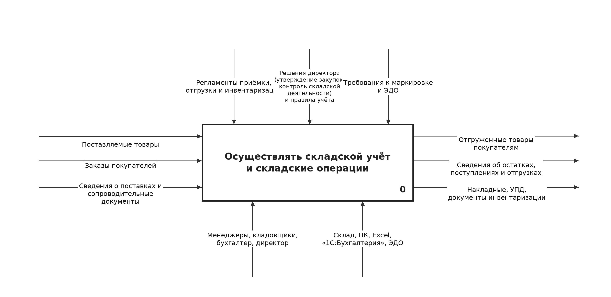
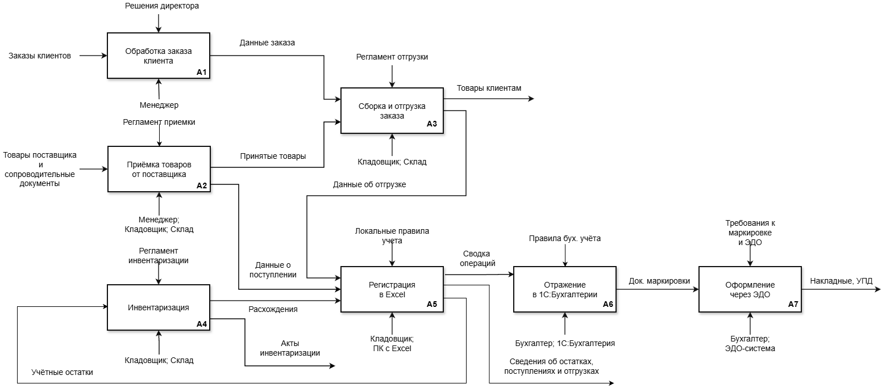
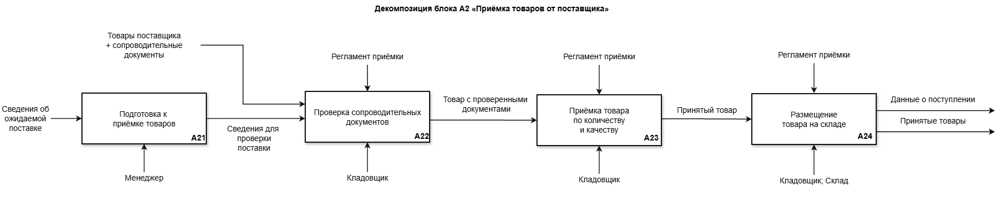
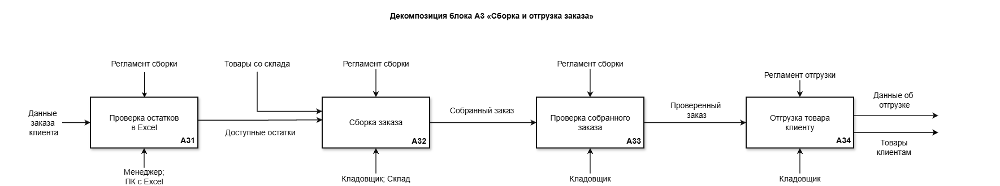
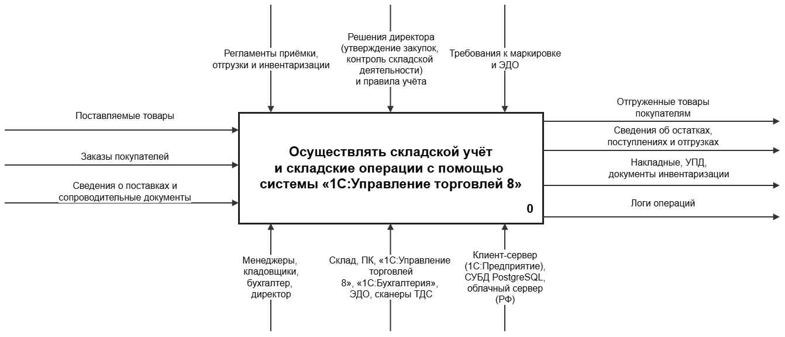
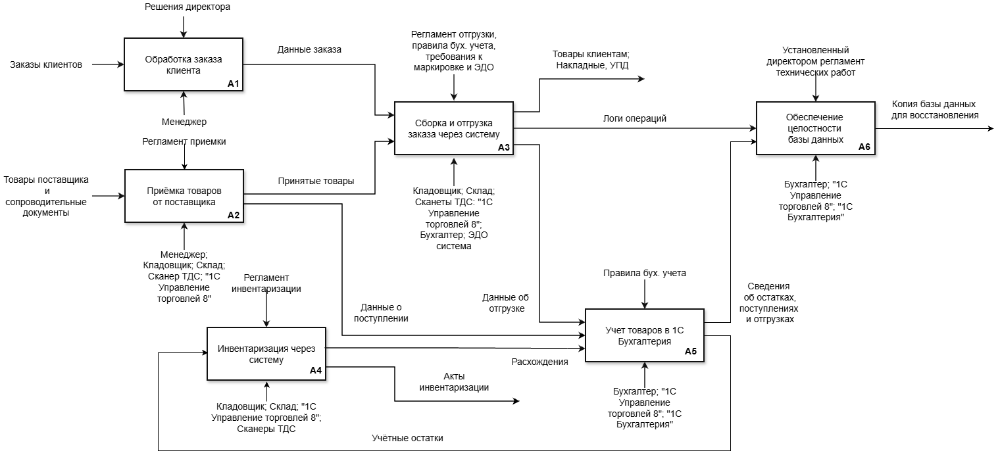
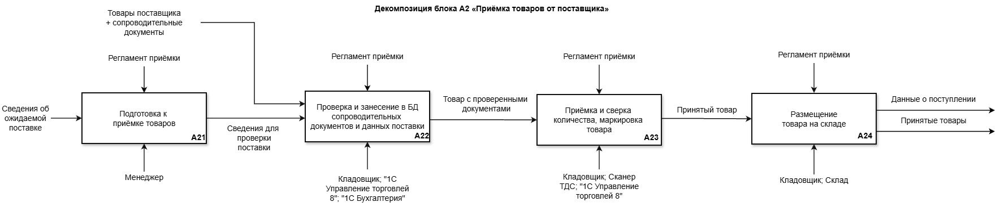
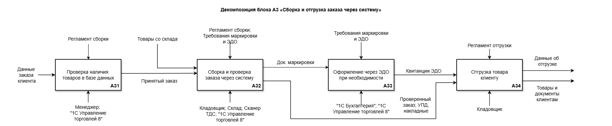

# Практическая работа № 3

## Разработка модели бизнес-процессов с учётом внедрения информационной системы

**Цель работы:** проектирование процессов компании для определения последствий внедрения разрабатываемой информационной
системы.

**Рассматриваемая организация:** ООО «Хозторг».

**Предлагаемая информационная система:** «1С:Управление торговлей 8» с использованием терминалов сбора данных (ТСД).

## 1. Контекстная диаграмма IDEF0 до внедрения информационной системы

*Рисунок 1 — Контекстная диаграмма складского учёта ООО «Хозторг» до внедрения информационной системы (AS-IS).*

Контекстная диаграмма IDEF0 отражает существующий процесс складского учёта ООО «Хозторг» до внедрения информационной
системы.

Входами процесса являются поставляемые товары, заказы покупателей и сведения о поставках. Выходами выступают отгруженные
товары, информация о складских остатках и операциях, а также оформленные документы. Управление процессом осуществляется
на основании внутренних регламентов, решений руководства и требований законодательства. Механизмами являются сотрудники
предприятия, складская инфраструктура и существующие средства учёта: Excel, «1С:Бухгалтерия» и ЭДО.

В текущем состоянии складской учёт ведётся преимущественно вручную, а обмен данными между используемыми системами не
автоматизирован.

## 2. Декомпозиция первого уровня IDEF0 до внедрения информационной системы

*Рисунок 2 — Декомпозиция первого уровня складского учёта (AS-IS).*

Данная диаграмма представляет декомпозицию первого уровня контекстного блока A0 и показывает семь основных функций
складского учёта ООО «Хозторг» в текущем состоянии (AS-IS): обработку заказа клиента (A1), приёмку товаров от
поставщика (A2), сборку и отгрузку заказа (A3), проведение инвентаризации (A4), регистрацию операций в Excel (A5),
отражение операций в «1С:Бухгалтерии» (A6) и оформление документов через ЭДО (A7).

Данные заказа из A1 и принятые товары из A2 поступают в блок сборки и отгрузки A3. Сведения о поступлении, отгрузке и
расхождениях, выявленных при инвентаризации, передаются в A5. Далее сведения проходят учётную цепочку: Excel →
«1С:Бухгалтерия» → ЭДО. Результаты инвентаризации используются для корректировки учётных остатков.

Управление осуществляется через решения директора, регламенты приёмки и отгрузки, правила бухгалтерского учёта и
требования ЭДО; механизмами выступают менеджер, кладовщик, бухгалтер, а также ПК с Excel, «1С:Бухгалтерия» и система
ЭДО.

Диаграмма демонстрирует, что регистрация в Excel и отражение в «1С:Бухгалтерии» вынесены в отдельные блоки с ручной
передачей данных между ними, что визуализирует проблему двойного ввода и отсутствия интеграции между используемыми
системами.

## 3. Декомпозиция второго уровня IDEF0 до внедрения информационной системы

### 3.1. Декомпозиция блока A2 «Приёмка товаров от поставщика»

*Рисунок 3 — Декомпозиция блока A2 «Приёмка товаров от поставщика» (AS-IS).*

### 3.2. Декомпозиция блока A3 «Сборка и отгрузка заказа»

*Рисунок 4 — Декомпозиция блока A3 «Сборка и отгрузка заказа» (AS-IS).*

Данные диаграммы представляют декомпозиции второго уровня двух блоков первого уровня, детализирующие ключевые складские
процессы в текущем состоянии (AS-IS).

Блок A2 «Приёмка товаров от поставщика» декомпозирован на четыре подфункции: подготовку к приёмке товаров (A21),
проверку сопроводительных документов (A22), приёмку товара по количеству и качеству (A23) и размещение товара на
складе (A24). Блок A3 «Сборка и отгрузка заказа» декомпозирован на четыре подфункции: проверку остатков в Excel (A31),
сборку заказа на складе (A32), проверку собранного заказа вручную (A33) и отгрузку товара клиенту (A34).

Входами первой декомпозиции являются сведения об ожидаемой поставке и товары поставщика с документами, выходами — данные
о поступлении и принятые товары на склад. Входами второй — данные заказа клиента и товары на складе, выходами — товары
клиентам и данные об отгрузке. Данные о поступлении и об отгрузке передаются в блок A5 (регистрация в Excel) на
родительском уровне.

Управление осуществляется через регламент приёмки (в A2) и регламент сборки и отгрузки (в A3); механизмами выступают
менеджер, кладовщик, склад и ПК с Excel.

Декомпозиции показывают, что сверка документов, проверка товара, поиск на складе и контроль сборки выполняются вручную,
без сканера штрихкодов и без системы адресного хранения, что является источником ошибок и потери времени на обоих
этапах — приёмки и сборки.

## 4. Диаграммы IDEF0 после внедрения информационной системы

### 4.1. Контекстная диаграмма после внедрения системы

*Рисунок 5 — Контекстная диаграмма складского учёта после внедрения информационной системы (TO-BE).*

Диаграмма отражает складской учёт ООО «Хозторг» с использованием «1С:Управление торговлей 8». Основные входы и выходы
процесса сохраняются: на вход поступают товары, заказы и сведения о поставках, на выходе формируются отгруженные товары,
данные об остатках и операциях, а также документы. Дополнительно предусмотрены журналы операций.

Управление осуществляется на основании регламентов, решений директора и требований к учёту и ЭДО. Механизмами наряду с
работниками и складом становятся «1С:Управление торговлей 8», терминалы сбора данных, «1С:Бухгалтерия», ЭДО и серверная
инфраструктура. Таким образом, общая структура процесса существенно не меняется, но изменяются средства его выполнения.

### 4.2. Декомпозиция первого уровня после внедрения системы

*Рисунок 6 — Декомпозиция первого уровня складского учёта после внедрения информационной системы (TO-BE).*

Диаграмма включает шесть функций: обработку заказа клиента (A1), приёмку товаров от поставщика (A2), сборку и отгрузку
заказа через систему (A3), инвентаризацию через систему (A4), учёт товаров в «1С:Бухгалтерии» (A5) и обеспечение
целостности базы данных (A6).

Данные заказов передаются из A1 в A3, а принятые товары — из A2 в A3. Сведения о поступлении, отгрузке и расхождениях,
выявленных при инвентаризации, поступают в A5 «Учёт товаров в 1С:Бухгалтерии». Учётные остатки из A5 используются при
инвентаризации в A4.

Отдельные блоки регистрации в Excel и оформления документов через ЭДО на диаграмме не выделены. Оформление документов
через ЭДО включено в сборку и отгрузку заказа (A3). Эти изменения направлены на сокращение повторного ввода данных.

В блок обеспечения целостности базы данных (A6) поступают журналы операций из A3 и сведения об остатках, поступлениях и
отгрузках из A5. Результатом A6 является копия базы данных для восстановления. Работы выполняются по регламенту,
установленному директором.

### 4.3. Декомпозиция блока A2 «Приёмка товаров от поставщика» после внедрения системы

*Рисунок 7 — Декомпозиция блока A2 «Приёмка товаров от поставщика» (TO-BE).*

Процесс включает подготовку к приёмке товаров (A21), проверку и занесение в базу данных сопроводительных документов и
сведений о поставке (A22), приёмку и сверку количества товаров, их маркировку (A23), размещение товара на складе (A24).

На вход поступают сведения об ожидаемой поставке и товары поставщика с сопроводительными документами. Процесс
выполняется по регламенту приёмки. В нём участвуют менеджер и кладовщик; используются склад, программы 1С и ТСД.

По сравнению с процессом до внедрения системы сохраняются основные этапы приёмки, но проверенные документы и сведения о
поставке регистрируются в базе данных, а при сверке товаров используются сканер ТСД и «1С:Управление торговлей 8».
Результатом являются принятые товары и данные о поступлении.

### 4.4. Декомпозиция блока A3 «Сборка и отгрузка заказа» после внедрения системы

*Рисунок 8 — Декомпозиция блока A3 «Сборка и отгрузка заказа» (TO-BE).*

Процесс состоит из проверки наличия товаров в базе данных (A31), сборки и проверки заказа через систему (A32),
оформления документов через ЭДО при необходимости (A33) и отгрузки товара клиенту (A34).

На вход поступают данные заказа клиента и товары со склада. Процесс выполняется по регламентам сборки и отгрузки с
учётом требований к маркировке и ЭДО. В нём участвуют менеджер и кладовщик; используются склад, программы 1С и ТСД.

Кладовщик собирает и проверяет заказ с помощью информационной системы и ТСД. В блок отгрузки поступают проверенный
заказ,
документы и квитанции ЭДО. На выходе формируются товары и документы для клиента, а также сведения об отгрузке.

## 5. Пояснения к построенным диаграммам

На контекстных диаграммах (рисунки 1 и 5) показано, что назначение складского учёта и основные потоки товаров и
документов остаются прежними. Изменяются средства выполнения операций: вместо разрозненного учёта используются «1С:
Управление торговлей 8», ТСД и связанные с системой средства обработки данных.

Декомпозиции первого уровня (рисунки 2 и 6) показывают изменение организации учёта. В исходном процессе регистрация в
Excel, отражение в «1С:Бухгалтерии» и оформление через ЭДО представлены отдельными операциями. В модели TO-BE отдельная
регистрация в Excel не предусмотрена, оформление через ЭДО включено в сборку и отгрузку заказа. Также выделена функция
обеспечения целостности базы данных.

Декомпозиции приёмки (рисунки 3 и 7) сохраняют последовательность проверки документов, товаров и размещения на складе.
Основное отличие — регистрация сведений в базе данных и применение сканирования при сверке товаров.

Декомпозиции сборки и отгрузки (рисунки 4 и 8) отражают замену проверки остатков в Excel проверкой наличия товаров в
базе
данных. Сборка и проверка заказа объединены в один блок с использованием информационной системы и ТСД. Физическую сборку
и передачу товаров по-прежнему выполняют сотрудники, а оформление через ЭДО входит в процесс сборки и отгрузки.

## 6. Основные различия бизнес-процессов до и после внедрения информационной системы

| Бизнес-процесс                 | До внедрения информационной системы                                          | После внедрения информационной системы                                                                                  |
|--------------------------------|------------------------------------------------------------------------------|-------------------------------------------------------------------------------------------------------------------------|
| Приёмка товаров                | Проверка документов и товаров вручную, последующая регистрация сведений      | Занесение документов и сведений о поставке в базу данных, сверка количества и маркировка товаров с применением ТСД      |
| Проверка остатков              | Использование Excel                                                          | Проверка наличия товаров в базе данных «1С:Управление торговлей 8»                                                      |
| Сборка заказа                  | Ручная сборка и отдельная ручная проверка                                    | Сборка и автоматизированная проверка заказа с использованием информационной системы и ТСД                               |
| Отгрузка и ЭДО                 | Отгрузка и оформление документов через отдельный блок ЭДО                    | Обработка электронных документов включена в процесс сборки и отгрузки, при необходимости выполняется через ЭДО          |
| Инвентаризация                 | Ручной пересчёт, сопоставление с данными учёта                               | Инвентаризация через систему с применением ТСД и передачей расхождений в учёт                                           |
| Складской и бухгалтерский учёт | Регистрация в Excel с последующим ручным переносом данных в «1С:Бухгалтерию» | Передача сведений о складских операциях в «1С:Бухгалтерию»; отдельный этап регистрации в Excel отсутствует              |
| Обеспечение целостности данных | Отдельная функция обеспечения целостности базы данных не выделена            | Выделен блок обеспечения целостности базы данных; предусмотрены журналы операций и копия базы данных для восстановления |

В модели TO-BE сохраняются основные складские операции: приёмка, сборка, отгрузка и инвентаризация. Для их выполнения
используются «1С:Управление торговлей 8» и ТСД. Проверка наличия товаров выполняется по базе данных, сборка и проверка
заказа объединены, а оформление через ЭДО включено в процесс сборки и отгрузки. Ожидаемые результаты этих изменений —
сокращение повторного ввода данных, снижение вероятности ошибок и уменьшение времени обработки товаров и заказов.
