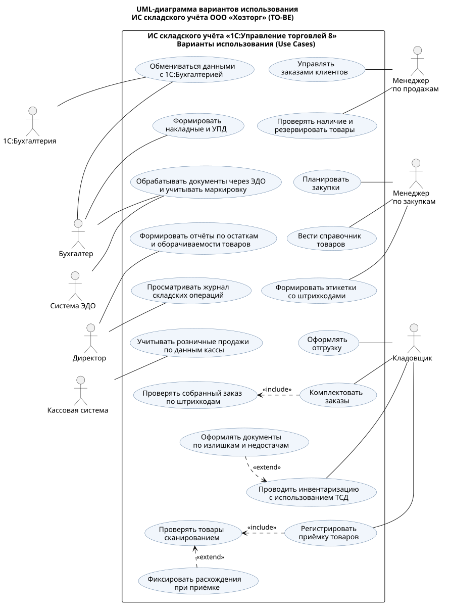
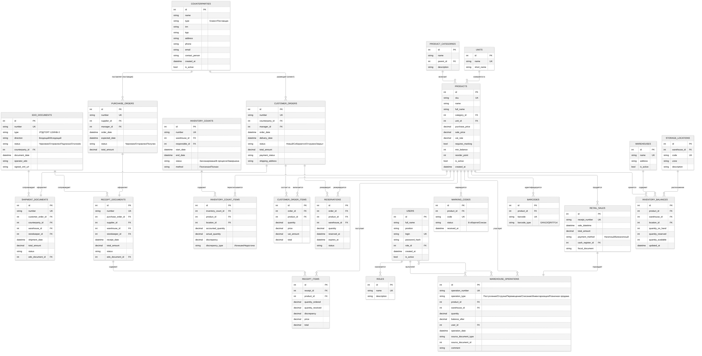
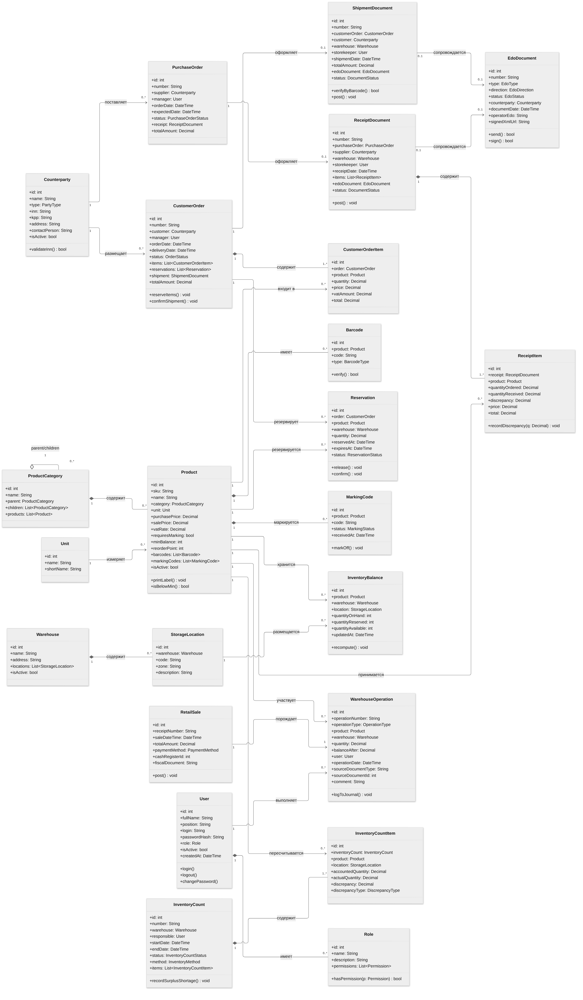
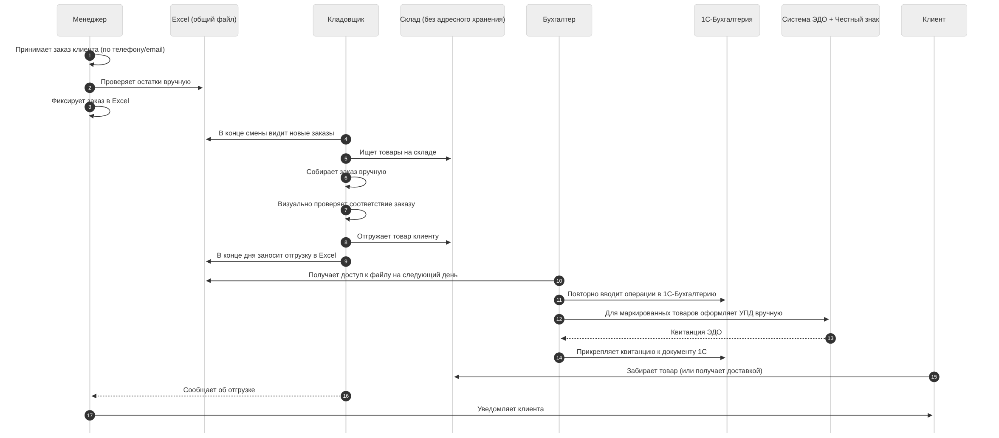
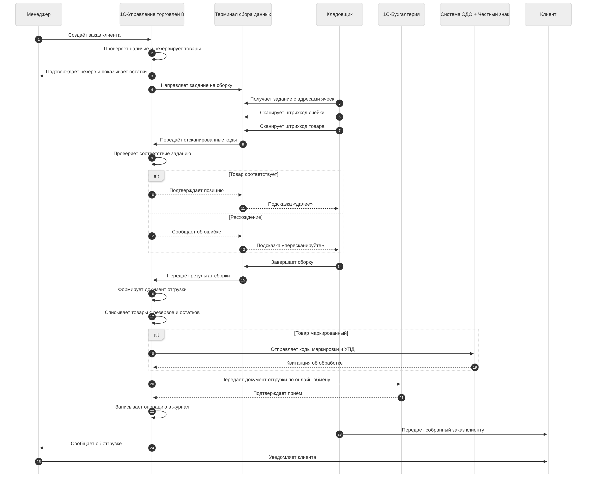
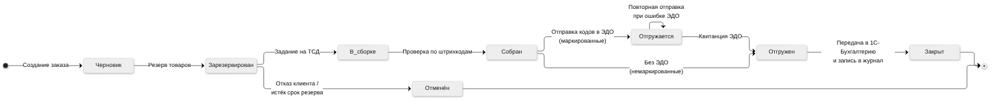
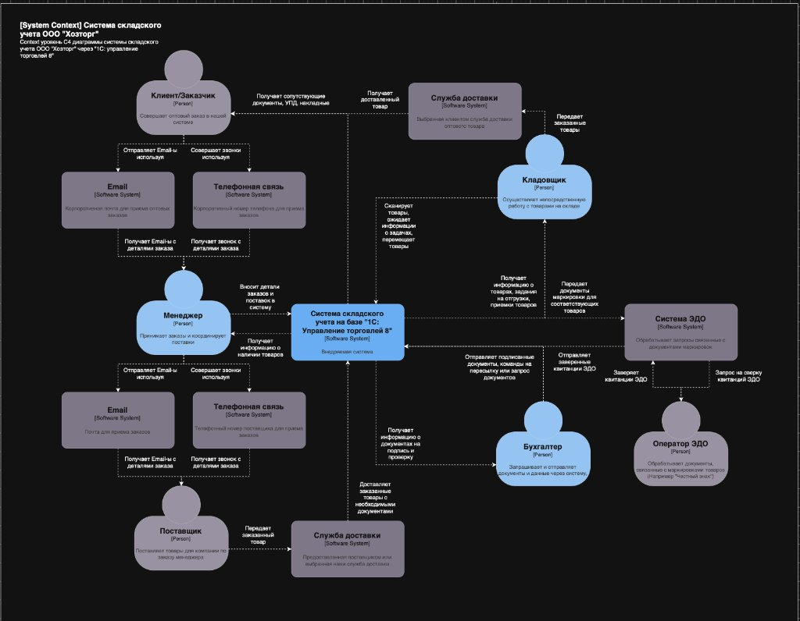
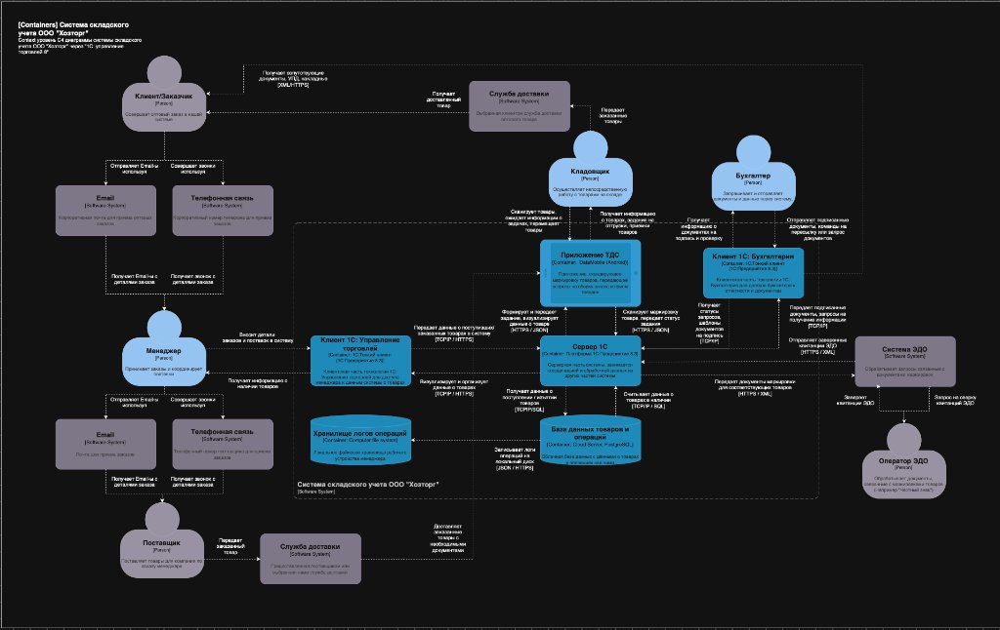
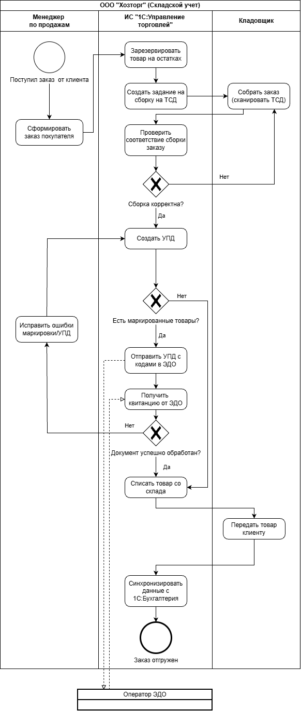
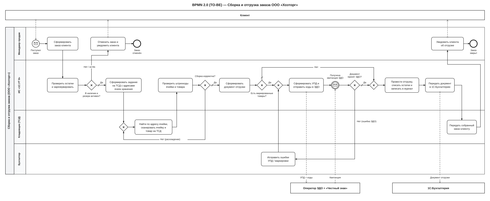

# Практическая работа № 4

## Описание информационной системы с помощью различных нотаций

**Цель работы:** описание разных аспектов разрабатываемой информационной системы с использованием нотаций UML, ERD и C4.

**Рассматриваемая организация:** ООО «Хозторг».

**Предлагаемая информационная система:** «1С:Управление торговлей 8» с использованием терминалов сбора данных (ТСД).

## 1. UML-диаграмма вариантов использования

*Рисунок 1 — UML-диаграмма вариантов использования ИС складского учёта ООО «Хозторг» (TO-BE).*

## 2. Диаграмма ERD и UML-диаграмма классов

### 2.1. ERD-диаграмма

*Рисунок 2 — ERD-диаграмма ИС складского учёта ООО «Хозторг».*

Построенная ERD-диаграмма отражает логическую модель данных информационной системы складского учёта ООО «Хозторг» на базе «1С:Управление торговлей 8». Модель содержит 26 сущностей, объединённых в шесть функциональных групп: пользователи и доступ, справочники товаров, контрагенты, складские ресурсы, документы движения и инвентаризация с аудитом. Сущности связаны 28 отношениями типа «один-ко-многим» и «один-к-одному», что обеспечивает ссылочную целостность базы данных при выполнении складских операций. Каждой сущности назначен первичный ключ (PK), внешние ключи (FK) обеспечивают связи с родительскими сущностями, а уникальные ключи (UK) исключают дублирование номеров документов, штрихкодов, кодов маркировки и логинов пользователей.

Центральным информационным узлом модели является сущность PRODUCTS, которая связана с восемью другими сущностями: штрихкодами, кодами маркировки, остатками на складах, резервами, позициями документов приёмки и отгрузки, строками инвентаризации и складскими операциями. Такая структура позволяет системе вести единый справочник товаров (около 2 500 позиций согласно работе № 2) и обеспечивать сквозной учёт движения каждой товарной позиции: от поступления на склад до отгрузки клиенту или списания по результатам инвентаризации.

Модель данных обеспечивает полное покрытие обязательных функциональных требований (ФТ-1 — ФТ-8) и часть необязательных (ФТ-9, ФТ-10, ФТ-11, ФТ-12), а также нефункциональное требование НФТ-1 о разграничении прав доступа. Сущность WAREHOUSE_OPERATIONS выполняет роль журнала регистрации (ФТ-8) и устраняет проблему П6 — отсутствие контроля изменений в общем файле Excel, выявленную в работе № 2. Сущность EDO_DOCUMENTS обеспечивает интеграцию с оператором ЭДО «Честный знак» (ФТ-7, О-6) и хранит подписанные XML-представления УПД, ТОРГ-12 и ИНВ-3 для обмена с 1С:Бухгалтерией (ФТ-6, О-5). Адресное хранение реализовано через сущность STORAGE_LOCATIONS, связанную с INVENTORY_BALANCES, что устраняет проблему П5 — отсутствие системы адресного хранения на складе.

### 2.2. UML-диаграмма классов

*Рисунок 3 — UML-диаграмма классов ИС складского учёта ООО «Хозторг».*

Дополнительно построенная UML-диаграмма классов отражает поведенческий аспект модели: на ней показаны методы классов, реализующие ключевые сценарии целевого процесса TO-BE «Сборка и отгрузка заказа». Диаграмма классов и ERD взаимно дополняют друг друга: ERD описывает структуру данных, а UML-диаграмма классов — поведение и интерфейс классов системы, что соответствует требованиям к дополнительным баллам за выполнение пункта 2 работы.

## 3. UML-диаграммы последовательности и диаграмма состояний

### 3.1. Диаграмма последовательности AS-IS

*Рисунок 4 — UML-диаграмма последовательности процесса «Сборка и отгрузка заказа» (AS-IS).*

### 3.2. Диаграмма последовательности TO-BE

*Рисунок 5 — UML-диаграмма последовательности процесса «Сборка и отгрузка заказа» (TO-BE).*

### 3.3. Диаграмма состояний

*Рисунок 6 — UML-диаграмма состояний заказа клиента.*

### 3.4. Сравнение диаграмм AS-IS и TO-BE

#### 1. Состав участников

| Тип участника | AS-IS | TO-BE |
|---|---|---|
| Люди | Менеджер, Кладовщик, Бухгалтер, Клиент | Менеджер, Кладовщик, Клиент (Бухгалтер выведен из прямого цикла) |
| Информационные системы | Excel, 1С-Бухгалтерия, Система ЭДО (три независимые системы) | 1С-Управление торговлей 8 (центральная), 1С-Бухгалтерия (приёмник), Система ЭДО (интегрирована) |
| Оборудование | ПК с Excel, без сканеров штрихкодов | ПК менеджера, 4 терминала сбора данных (ТСД) со встроенными 2D-сканерами |
| Склад | Без адресного хранения, поиск «на глаз» | Адресное хранение: ячейки с кодами, сканируются ТСД |
| Итого участников | 8 | 7 |

*Таблица 1 — Состав участников процесса AS-IS и TO-BE.*

#### 2. Число шагов (сообщений на диаграмме)

AS-IS: 17 сообщений  
TO-BE: 25 сообщений

Число шагов в TO-BE формально больше, но увеличение обусловлено детализацией автоматических проверок (резерв, маршрутизация на ТСД, сканирование ячейки и товара, сверка соответствия, формирование документа, отправка в ЭДО, обмен с 1С-Бухгалтерией). Эти шаги выполняются системой за секунды, тогда как в AS-IS каждый ручной шаг требовал минут или часов.

#### 3. Ручные операции

AS-IS: высокая доля ручного труда — ручная проверка остатков в Excel (поиск по столбцам), ручной поиск товаров на складе, визуальная проверка собранного заказа без сканера, повторный ручной ввод данных из Excel в 1С-Бухгалтерию, отдельное ручное оформление УПД через ЭДО.

TO-BE: минимум ручного — сканирование штрихкодов ячеек и товаров, нажатие кнопок подтверждения на ТСД. Все остальные операции (проверка остатков, резерв, маршрутизация задания, сверка, формирование документа отгрузки, обмен с ЭДО и 1С-Бухгалтерией, запись в журнал) выполняются 1С-Управление торговлей 8 автоматически.

#### 4. Двойной ввод данных

AS-IS: есть — кладовщик заносит отгрузку в Excel в конце дня, бухгалтер на следующий день повторно вводит те же операции в 1С-Бухгалтерию. По оценке работы № 2 — около 10 часов в неделю бухгалтерского времени (проблема П3).

TO-BE: устранён — документ отгрузки передаётся из 1С-УТ 8 в 1С-Бухгалтерию по встроенному онлайн-обмену в день отгрузки (ФТ-6, О-5).

#### 5. Актуальность остатков

AS-IS: остатки обновляются только к концу рабочего дня после занесения всех отгрузок в Excel (проблема П2). Примерно каждый 20-й заказ требует корректировки после сборки из-за устаревших данных.

TO-BE: остатки актуальны в реальном времени — система автоматически резервирует товары при создании заказа и списывает их при проведении документа отгрузки (ФТ-3, ФТ-4). Проблема П2 устранена.

#### 6. Проверка сборки

AS-IS: визуальная проверка кладовщиком без сканера. Примерно каждый 20-й заказ (около 5%) требует корректировки после сборки. Возникают пересортица и расхождения с учётом (проблемы П1, П5).

TO-BE: сканирование штрихкода ячейки и штрихкода товара на ТСД; 1С-УТ сверяет отсканированные коды с заданием. При расхождении система сообщает об ошибке и требует пересканировать позицию; только после подтверждения всех позиций сборка считается завершённой (ФТ-3). Проблемы П1 и П5 устранены.

#### 7. Поиск товара на складе

AS-IS: без системы адресного хранения, кладовщик ищет товар «на глаз» — до 30 минут на заказ, часто приводит к пересорту.

TO-BE: адресное хранение с ячейками с кодами; задание на ТСД содержит адреса ячеек, что сокращает поиск до ~5 минут на заказ (ФТ-12).

#### 8. Оформление ЭДО и маркировки

AS-IS: бухгалтер отдельно оформляет УПД через систему ЭДО для маркированных товаров и вручную прикрепляет квитанцию к документу в 1С-Бухгалтерии. Отдельный ручной шаг в процессе.

TO-BE: ЭДО интегрировано в процесс отгрузки — 1С-УТ 8 автоматически отправляет коды маркировки и УПД в систему ЭДО при проведении документа отгрузки для маркированных товаров (ФТ-7, О-6). Отдельный ручной шаг не требуется.

#### 9. Контроль изменений

AS-IS: любой сотрудник с доступом к общему файлу Excel может редактировать его без фиксации того, кто и когда внёс изменения. Контроль изменений отсутствует (проблема П6).

TO-BE: каждая операция фиксируется в журнале 1С-Управление торговлей 8 с указанием исполнителя и момента выполнения (ФТ-8). Проблема П6 устранена.

#### 10. Время выполнения процесса

AS-IS: оценочно ~50–70 минут на заказ (включая поиск ~30 мин, сборку 10–15 мин, ручную проверку ~5 мин, ручной ввод в 1С-Бухгалтерию на следующий день 5–10 мин) + задержка до следующего дня на ввод в учётную систему.

TO-BE: оценочно ~15–20 минут на заказ (поиск по адресам ячеек ~5 мин, сборка со сканированием ~10 мин, автоматическое формирование документа и обмен с 1С-Бухгалтерией — секунды). Документы в 1С-Бухгалтерии — в день отгрузки.

#### 11. Устраняемые проблемы

Внедрение целевой модели TO-BE устраняет 5 из 7 выявленных проблем текущего процесса (таблица 2).

| Код | Проблема | AS-IS | TO-BE |
|---|---|---|---|
| П1 | Расхождения между учётными и фактическими остатками (~6% позиций при инвентаризации) | Есть | Устранена (сканирование при сборке и инвентаризации) |
| П2 | Несвоевременное обновление остатков (~5% заказов правится после сборки) | Есть | Устранена (обновление в реальном времени) |
| П3 | Дублирование ввода данных в Excel и 1С (~10 ч/нед. бухгалтерского времени) | Есть | Устранена (онлайн-обмен 1С-УТ → 1С-Бухгалтерия) |
| П4 | Длительная инвентаризация (2 дня, остановка склада) | Есть | Не устраняется данной диаграммой (отдельный процесс) |
| П5 | Ошибки при приёмке и сборке из-за отсутствия сканера и адресного хранения | Есть | Устранена (сканирование + адресное хранение) |
| П6 | Отсутствие контроля изменений в Excel | Есть | Устранена (журнал 1С) |
| П7 | Неэффективное планирование закупок | Не отображена на диаграмме | Не отображена на диаграмме |

*Таблица 2 — Устраняемые проблемы из реестра работы № 2.*

#### 12. Вывод

Внедрение 1С-Управление торговлей 8 и терминалов сбора данных сокращает время выполнения процесса «Сборка и отгрузка заказа» примерно в 3 раза, устраняет двойной ввод данных, делает остатки актуальными в реальном времени, вводит автоматическую проверку сборки по штрихкодам и адресное хранение, интегрирует ЭДО в основной процесс и обеспечивает контроль изменений через системный журнал. Бухгалтер выведен из прямого цикла сборки и отгрузки — его роль сводится к контролю автоматически переданных документов в 1С-Бухгалтерии, что экономит около 10 часов в неделю его рабочего времени.

## 4. Описание основных компонентов системы (диаграмма C4)

### 4.1. Уровень контекста (System Context)

*Рисунок 7 — Диаграмма C4 (уровень System Context) ИС складского учёта ООО «Хозторг».*

### 4.2. Уровень контейнеров (Container)

*Рисунок 8 — Диаграмма C4 (уровень Containers) ИС складского учёта ООО «Хозторг».*

Поскольку в качестве целевого решения внедряется готовая тиражная информационная система «1С:Управление торговлей 8» без модификации её внутренней реализации, описание архитектуры в нотации C4 выполняется на уровнях контекста (System Context) и контейнеров (Container). Построение уровней компонентов (Component) и кода (Code) в данном случае нецелесообразно и невозможно, так как внутренняя структура программных компонентов и исходный код систем 1С закрыты и не разрабатываются командой проекта.

## 5. Анализ и доработка диаграммы BPMN из работы № 2

### 5.1. Исходная диаграмма BPMN (работа № 2)

*Рисунок 9 — Исходная BPMN-диаграмма целевого процесса «Сборка и отгрузка заказа» из работы № 2.*

### 5.2. Доработанная диаграмма BPMN

*Рисунок 10 — Доработанная BPMN-диаграмма целевого процесса «Сборка и отгрузка заказа» (TO-BE).*

### 5.3. Анализ и перечень внесённых изменений

Исходная диаграмма BPMN целевого процесса TO-BE «Сборка и отгрузка заказа» из работы № 2 (рисунок 9) включала три дорожки (менеджер по продажам, ИС «1С:Управление торговлей», кладовщик) и один внешний пул (оператор ЭДО). По результатам анализа диаграмм вариантов использования, ERD, последовательности и состояний, построенных в текущей работе, в BPMN-модель (рисунок 10) внесены следующие уточнения:

| Что было в BPMN (работа № 2) | Что изменено в обновлённой BPMN | Основание из текущей работы |
|---|---|---|
| Резервирование выполнялось безусловно, без проверки наличия и ветки отмены заказа | Добавлен шлюз «В наличии и резерв активен?», задача отмены заказа с уведомлением клиента и конечное событие «Заказ отменён» | В п. 1 (UC2), п. 2 (сущность RESERVATIONS со сроком действия резерва) и п. 3 (диаграмма состояний) предусмотрен отказ клиента и истечение резерва |
| Шаг сборки формулировался обобщённо: «Собрать заказ (сканировать ТСД)» | Уточнено: задание на ТСД содержит адреса ячеек, кладовщик сканирует штрихкоды ячейки и товара, а система проверяет их соответствие заданию | В п. 2 выделены сущности STORAGE_LOCATIONS и BARCODES, в п. 3 (диаграмма последовательности TO-BE) сборка выполняется по ячейкам с проверкой сканов |
| Ошибки маркировки и УПД исправлялись в дорожке «Менеджер по продажам» | Добавлена дорожка «Бухгалтер», куда перенесена обработка ошибок УПД и маркировки (при этом в штатном цикле отправка УПД в ЭДО выполняется 1С:УТ 8 автоматически) | По диаграмме вариантов использования (п. 1) работа с УПД и ЭДО относится к зоне ответственности бухгалтера, а по п. 3 в штатном процессе бухгалтер выведен из прямого цикла |
| Сразу создавался УПД без складского документа отгрузки и без фиксации в журнале операций | Выделены формирование документа отгрузки и проведение отгрузки со списанием остатков и записью в журнал складских операций | В п. 2 разделены SHIPMENT_DOCUMENTS и EDO_DOCUMENTS, а запись каждой операции в WAREHOUSE_OPERATIONS требуется по ФТ-8 (п. 1–3) |
| Синхронизация с «1С:Бухгалтерией» была показана без внешнего пула; отсутствовал шаг уведомления клиента | Добавлены внешние пулы «Клиент» и «1С:Бухгалтерия» с потоками сообщений, а также уведомление клиента об отгрузке и закрытие заказа | Согласование с диаграммой последовательности TO-BE (шаги 20–25) и диаграммой состояний (переход «Отгружен → Закрыт») |

Доработанная диаграмма BPMN сохраняет базовую логику целевого процесса из работы № 2, но устраняет несоответствия по зонам ответственности, исключительным веткам (отмена резерва, расхождения при сканировании, ошибки ЭДО), журналированию операций и взаимодействию с внешними системами.
